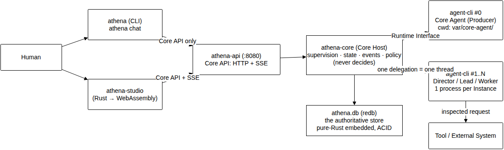
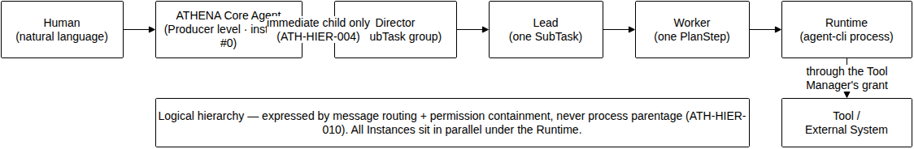
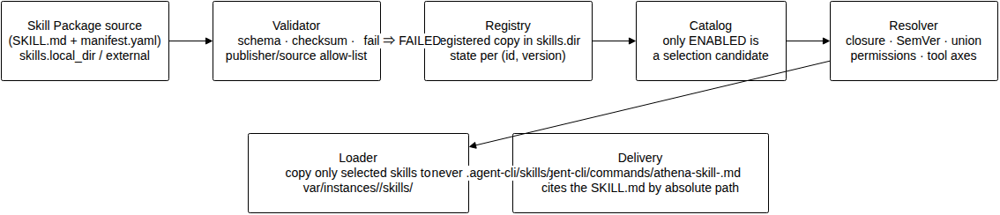

# ATHENA システム概要

| 項目 | 内容 |
|---|---|
| Version | 1.0(2026-10-18) |
| 仕様の根拠 | `spec/athena_spec_1.0.md`(Version 1.0) |
| 英語版 | `docs/system-overview.md`(同一内容) |
| License | MIT |

> **必須記述**(`ATH-DOC-007`): ATHENA Core Agent **= AI Agent** であり、ATHENA Core ≠
> 単純な Scheduler である。また `athena-core`(Core Host)は**判断しない** — 監督・状態管理・
> 記録・ポリシー強制のみを担う。

## 1. システム概要

ATHENA は、自然言語で依頼された仕事を複数の AI Agent で組織して遂行するシステムアーキテクチャ
である。人間は一段の自然言語指示を出す。Core Agent 自身も AI Agent であり、
固定 Workflow を実行するのではなく、指示を理解し、計画し、Director / Lead / Worker の階層へ
委任し、戻ってきた結果を評価し、必要ならば再計画する。構成は5つの実行ユニット —
`athena-api`(常駐の Core API)、`athena-core`(Core Host ライブラリ)、
`athena-runtime-agent-cli`(Runtime Adapter)、`athena` CLI、`athena-studio`(Rust →
WebAssembly)— と、永続状態を一手に担う単一の権威あるストア(`athena.db`、純 Rust 埋め込み型エンジン `redb`)である。

## 2. 解決する問題

単一の長命 AI Agent の稼働では実務の負荷に耐えられない: コンテキストが氾濫し、一つの失敗が
全体を止め、高リスク操作が無防御で実行され、誰が何をなぜ行ったかの再構成可能な記録がない。
ATHENA は、仕事を小さく責務の明確な単位へ分解する階層、全状態遷移の Event ベースの永続記録、
Agent を独立プロセス + Agent 毎の権限境界で隔離する構造、そして必要な操作のみ人間の承認を
要求する仕組みでこれを解く。

## 3. 設計思想(4つの不変条件)

どの設計判断も次の4不変条件に支配される。1つに反する変更は、トレードオフではなく仕様違反と
みなす。

1. **中心は AI Agent であって Scheduler ではない。** Core Host は監督・記録のみ; 判断は行わない。
2. **思考は `agent-cli` 上の Agent Process で行う。** Core Agent(instance #0)を含み、Core Host は推論を持たない。
3. **Agent Process は信頼境界の外側。Core Agent を含む。** Core Host が唯一の Policy
   Enforcement Point である。
4. **階層は論理的** — メッセージルーティング + 権限包含で表現し、プロセス親子関係では決して
   実現しない。全 Instance は Runtime 配下に並列に置かれる。

分布より簡潔を優先し、v1 では API と Core Host は同一プロセス内で動作する。

## 4. システム全体構成



リクエストの唯一の入口は Core API(`/api/v1`)であり、CLI と Studio は同一表面の薄い UI とし
て接続する。Core Host は Agent Process を排他的に Runtime Interface 経由で駆動し、意味のある
状態遷移はすべて状態の書込みと同一トランザクション内で Event として永続される。

## 5. ATHENA Core Agent

Core Agent は判断を担う Producer レベルの AI Agent である。ループは Understand → Plan →
Decide → Act → Observe → Evaluate → Re-plan。専用・長命の `agent-cli` instance #0 として
(`spawn` で起動、cwd `var/core-agent/`)稼働し、セッションスコープ、特定 Task に束縛されず、
通信は Message Broker を経由するのみ。権限のある要求(エージェント開始、tool 実行、状態遷移、
skill 有効化、承認消費)は、すべて型付き `CoreRequest` として Core Host の検査を通過する。
識別子と Plan リビジョンの発行は Core Host のみ。Core Agent の障害時、復旧手順は決定論的で
ある — 制御面チェックサム検証、Working Memory と Events からの文脈再構築、所定の再起動枠内
での再起動と再注入; 枠を使い果たしたら人間へエスカレートし、Core Host が自身の判断で
代用することはない。

## 6. Agent Hierarchy



4レベルで、単位との対応は決定論的な写像である: Producer ↔ ルート Task、
Director ↔ SubTask の群、Lead ↔ 一つの SubTask、Worker ↔ 一つの PlanStep。委任は直下の
レベルのみ(Core Agent が明示的に許可したレベルスキップを除く)、深さの既定値は4、
`allowed_tools(child) ⊆ delegable_tools(parent)`、同レベルの Instance は既定で並列実行。
階層は一意な親を持つ非循環の木であり、Agent が Agent を開始することは決してなく、Instance の
生成は Core Host だけが行う。

## 7. Agent 間通信

Agent 間の全通信は Core Host 内の Message Broker を通過し、Agent 同士は決して直接接続され
ない。メッセージは §10.2 の封筒に適合し、`thread_id` は Core Host が発行(1委任=1スレッド)、
順序はスレッド内で保証、配信は at-least-once で重複排除は Broker 側が担う。
`instruction`/`question` には回答期限があり、兄弟間通信は明示的に記録された `sibling_acl`
の許可を必要とする。`report` / `complete` / `error` / 制御メッセージは決して破棄・拒否され
ず、制御メッセージ(cancel / interrupt)はキューを飛び越える。

## 8. Runtime / agent-cli

Runtime Interface(`start` / `send` / `receive` / `status` / `stop` / `collect_result` /
`capabilities`)は具象 Adapter より先に確定する。Core は Runtime 種別に分岐してはならず、
Adapter は起動時にレジストリへ自ら登録し、全 Adapter が一つの共通コントラクトテストを通過す
る。`agent-cli` Adapter は Agent Instance 毎に独立した Workspace(`var/instances/<id>/`; Core
Agent は `var/core-agent/`)を cwd として与え、テンプレートから `.agent-cli/` を生成する
(完全な `config.toml`、手順ファイルの `commands/`、`persona.md`)。起動前に aiprj の準備状
態を検査し、未初期化のときのみ書込み領域を初期化する。起動/実行期限と heartbeat を強制し、
优雅な停止と強制終了を区別し、異常終了は `RuntimeError` として報告する。手順ファイルは絶対
パスで読まれ、スラッシュコマンドとして呼ばれることはない。

## 9. Tool

既定 tool set は9種(`fs_read`、`fs_write`、`shell`、`git`、`search`、`send_to`、`process`、
`terminal`、`network`)で既定リスクが固定。権限は Agent 毎に付与し、既定は拒否。Core Host の
Tool Manager が強制点であり、権限外の要求は `PermissionError`。`fs_read`/`fs_write` はパス
境界(Workspace ∪ work targets; 制御面は除外 — **除外が最優先**)に閉じ込められ、高リスク
実行は先に承認をとる。開始・完了・失敗は Events と `tool_executions` 行として記録される。

## 10. Memory

3階層を構造的に分離する。Short Term(Agent Process 側 `[history]`、設定で命名したトークナ
イザで計数)、Working(Task スコープ、終端状態まで — 再起動時の文脈セットを保持)、
Long Term(Project スコープ、明示的な書込みのみ — Core Agent の明確な判断か人間の指示。
出典を保持し、削除は Event で記録、上限到達時は沈黙の消化ではなく拒否・エスカレーション)。
退避時の要約は `memory.summarizer` が指定する Agent への委任(LLM 処理)であり、利用不能
な場合は参照(Event ID / Result ID)のみを保持する。v1 の全階層は Repository interface を
介した同一の永続ストア(第 27 章。エンジンは `redb`)に置く。

## 11. Skill



Skill Package は `SKILL.md`(Agent が読む本体)+ `manifest.yaml`。パイプラインは Validator →
Registry(登録した複製を `skills.dir` に、状態は `(id, version)` 毎)→ Catalog(`ENABLED` の
みが候補)→ Resolver(推移的閉包・SemVer の最大適合・権限和集合·tool の二軸検証)→ Loader(
選択された skill のみを Instance の `skills/` に配置)→ Delivery(実体を絶対パスで指す
Skill 毎の手順ファイル)。稼働中の追加が次の Task から利用可能; ホットリロードは
`hot_reload_safe` の宣言 + `ATH-SEC-012` の権限再検査 + 新しいリビジョン記録が必要。優先順
位は ATHENA Security/System policy ▸ aiprj ルール ▸ skill 手順 ▸ Task プロンプトであり、
skill は上位の規則を無効化できない。外部取得 skill は publisher/source の allow-list に管理
され、高リスクの使用事には承認を要する。

## 12. Human-in-the-Loop

設定で `high` と分類された操作は実行前に人間の承認を要する。人が判定するのは Core Host が
**生成する規範的記述(canonical operation descriptor)** であり、Agent の `reason`/`impact`
プローズは付随表示され、**信頼不能** と明示され、分類の根拠にはならない。承認には期限
(無応答 ⇒ 拒否)があり、1承認=1操作; pattern scope は設定された列挙から選択し TTL の上限
で拘束する。消費時に再分類し、提示された分類より高い種別の操作は新しい承認を要求する。承認待ち
Instance は `SUSPENDED`(プロセスを保持しない)とし、比率で上限を設ける。 Clarification
(`ask_human`)は Task を `WAITING_INPUT` に移し、独立した期限を用意する — 期限経過は Task の
失敗であり、沈黙は決して回答として読まない。

## 13. 実行フロー

```text
Human instruction → Task CREATED → QUEUED
  → Core Agent: SubmitUnderstanding / SubmitPlan(id 発行 + revision 増分)
  → Decide: ComposeHierarchy(admission control)— AgentSelected / SkillSelected
  → Act: Delegate / ExecuteTool(冪等キー)、高リスクは承認ゲート
  → Worker が Instance 上で PlanStep 実行 → report → Result → store 複製
  → Evaluate: 検証可能な成果物には客観的 Verification(受理の根拠)
  → SUCCESS / RETRYING / REPLANNING / FAILED + 理由と試行の履歴
```

## 14. 状態とイベント

5つの状態機械(Task、Agent Instance、Skill、Approval、PlanStep)を §17 の表どおり実装する。
遷移は State Manager が中央管理し、`expected_state` チェックで検証し、全遷移が同一
トランザクションで対応する Event を付与する。Event は §23.1 封筒(per-Core 単調な
`sequence`、Task 単位の順序)、不変、秘密・Agent 入力全文を含まず、永続後に SSE 配信、
`sequence` での欠損取得に対応し、再生は観測のみで副作用を起こさない。保持は既定 90 日で、
最終 Result と Results を保つ。

## 15. セキュリティ

Agent Process は — Core Agent を含めて — 信頼対象外であり、Core Host が唯一の Policy
Enforcement Point である。API は3ロール(`viewer` / `operator` / `admin`)の Bearer トークン
で護られ、トークンはハッシュのみ保管; `healthz` のみが未認証で内部状態に晒されない。権限は
既定最小、委任で拡大はできず、Agent が自身の権限を変更できる操作は存在しない
(wire schema 監査を含めて構造的に実証)。filesystem スコープは制御面を除外し、秘密は導線の
どこにも平文で現れない。

## 16. 開発・拡張方針

リポジトリは単一の Cargo ワークスペースであり、依存方向は CI が機械的に強制する(許可表に
ない辺は失敗)。言語は Rust 一択; ブラウザ UI は Rust → WebAssembly。拡張は新しい Runtime
Adapter の登録(Core 変更なし)、Registry を通じた skill 追加、Core API のみを経由しての
運用のいずれかで行い、Core 内部に到達する形での拡張は禁止する。Phase 9(Hub)・Phase 10
(SDK)は要求が実際に発生するまで着手しない。
